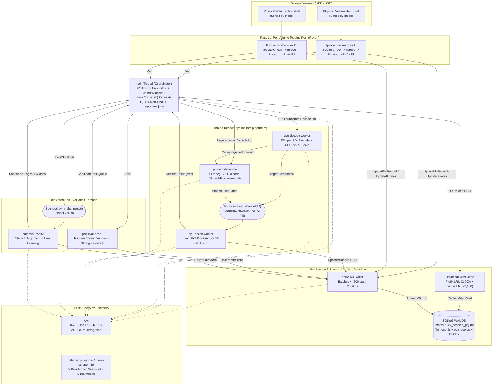

# 01 — Multi-Threaded Architecture

`rusty_dedup` is architected as a **staged, bounded-memory multi-threaded pipeline** designed to saturate a single host's GPU video decoder and spinning HDD I/O sequentially without blowing up RAM or thrashing drive heads across **300,000+ video files (~80 TB)**.

---

## 1. Design Principles

1. **Sequential Platter Discipline (Per-Volume `BTreeMap<(dev_id, inode)>`)**:
   - External spinning HDDs collapse from ~180 MB/s to <2 MB/s under random multi-threaded seeks.
   - `rusty_dedup` groups discovered files by physical OS device ID (`dev_id`), sorts monotonically by `(dev_id, inode, path)`, and assigns **1 sequential worker per physical volume** by default (`--hdd-concurrency 1`). Multiple external drives probe in parallel via Rayon while each individual platter is read in strict monotonic inode order.
2. **Heterogeneous Decode Offload with Strict GPU Fast-Fail**:
   - Hardware video decoding (VideoToolbox, CUDA/NVDEC, D3D12VA/D3D11VA, QSV, VAAPI, Vulkan, etc.) runs on a dedicated `gpu-decode-worker` thread, downscaling frames on-GPU to **`72×72` grayscale** (~5 KB/frame — 600× smaller than 1080p!) before crossing the PCIe/memory bus.
   - Legacy codecs unsupported by the GPU (e.g., `WMV2`, `MPEG4`, `DIVX`, or unsupported profiles) are routed cleanly to `cpu-decode-worker` so GPU and CPU decoding overlap in parallel.
   - Driver/hardware failures **never silently fall back to CPU** — they abort cleanly with diagnostic links.
3. **Bounded Memory via Backpressure & LRU + SQLite3 BLOB Offload**:
   - Raw `72×72` luma buffers move from decode workers to `cpu-dhash-worker` over `mpsc::sync_channel(16)` (`FRAME_CHANNEL_CAPACITY = 16`). If hashing ever falls behind decoding, decoders block naturally instead of growing RAM unboundedly.
   - In-memory 1-fps hash vectors are capped by two `BoundedHashCache` LRUs (`HASH_LRU_CAPACITY = 2000` videos each for 60s prefixes and full dense hashes). Heavy vectors live as compact little-endian `u64` BLOBs (8 bytes/second of video) in **SQLite3 WAL** (`.states/rusty_session_{sessionid}.db`), keeping total RAM flat (~75–150 MB) even at 300K files.
4. **Lock-Free Zero-Allocation Observability**:
   - All hot-path thread timers and 24-bucket latency histograms use `AtomicU64` (`Ordering::Relaxed`), avoiding mutex contention on worker threads.

---

## 2. Complete Thread Inventory

| OS Thread Name | Telemetry Role | Count | Primary Ownership | Inbound Channel / Input | Outbound Channel / Output |
| :--- | :--- | :--- | :--- | :--- | :--- |
| `main` | Coordinator | 1 | CLI, `--config-test`, `WalkDir`, Creator Directory, Pass 1b/2 orchestration, Union-Find clustering, `duplicates.json` output | CLI args, `DecodePipeline::recv()`, SQLite reader | `DecodeJob` → `gpu_tx`/`cpu_tx`, `Pass2EvalJob` → `eval_tx`, `DbWriteOp` → `db_tx` |
| Rayon per-volume workers | `ffprobe_workers` | 1 per physical `dev_id` (× `--hdd-concurrency`) | Pass 1a: SQLite cache check, single-header `ffprobe` (duration, resolution, codecs, video/audio bitrates), on-demand 0-bitrate re-probe, 192 KB BLAKE3 sample | `BTreeMap<dev_id, Vec<FileEntry>>` (inode-sorted) | `DbWriteOp::UpsertFileRecord` / `UpdateBitrates` → `db_tx`; returns `Vec<VideoRecord>` |
| `gpu-decode-worker` | `gpu_decode_worker` | 1 (when HW enabled) | Spawns HW-accelerated `ffmpeg` (`-hwaccel <backend>` + GPU `72×72` downscale) for `Sparse5`, `Prefix1Fps`, `Dense1Fps` | `gpu_rx` (`mpsc::channel<DecodeJob>`) | `StagedLumaBatch` → `stage_tx` (`sync_channel(16)`); per-file codec rejects → `cpu_tx` |
| `cpu-decode-worker` | `cpu_decode_worker` | 1 | Spawns fastest CPU `ffmpeg` decoder (`libdav1d`, `vp9`, `hevc`, `h264`, `wmv3`, etc.) for legacy/rejected codecs or CPU-only mode | `cpu_rx` (`mpsc::channel<DecodeJob>`) | `StagedLumaBatch` → `stage_tx` (`sync_channel(16)`) |
| `cpu-dhash-worker` | `cpu_dhash_worker` | 1 | Pure-Rust exact integer `8×9` block-average (`72×72 → 9×8`) + 64-bit horizontal gradient `dHash` | `stage_rx` (`sync_channel(16)`) | `DbWriteOp::Update*Hashes` → `db_tx`; `DecodeResult` → `result_tx` |
| `pair-eval-pass1` | `pair_evaluator_pass1` | 1 (Pass 1c) | $O(N \log N + K)$ runtime-sorted sliding window, pair categorization (`Strong`/`Weak`/`Potentially Distinct`), Pass-1 Strong fast-path & conflicting-creator triage | `Arc<Vec<VideoRecord>>` (runtime-sorted) | `DbWriteOp::UpsertPairScore` → `db_tx`; returns prioritized `Vec<CandidatePair>` + Pass-1 confirmed edges |
| `pair-eval-pass2` | `pair_evaluator_pass2` | 1 (Pass 2) | Stage E sliding-window alignment (`[-10s..+10s]`), confidence scoring (`>= 0.90`), automatic Creator Directory alias learning | `eval_rx` (`sync_channel(16)`) | `DbWriteOp::UpsertPairScore` → `db_tx`; returns confirmed edges + updated `CreatorDirectory` |
| `sqlite-wal-writer` | `sqlite_wal_writer` | 1 | Batches up to 500 mutations or every `--checkpoint-interval-ms` (default 2,000 ms) into atomic SQLite3 WAL transactions + `PRAGMA wal_checkpoint(TRUNCATE)` on shutdown | `db_rx` (`mpsc::channel<DbWriteOp>`) | `.states/rusty_session_{sessionid}.db` (WAL) |
| `telemetry-reporter` | Background | 0–1 | Periodic terminal heartbeats, 500 ms atomic JSON snapshot flushes for Python harness, optional Pushgateway `PUT` & `.prom` textfile export | Shared `Arc<TelemetryRegistry>` | `stderr`, `/tmp/rusty_dedup_telemetry_<pid>.json`, Pushgateway / `.prom` |
| `prom-scrape-http` | Background | 0–1 | Zero-dependency `TcpListener` serving `GET /metrics` & `/healthz` in standalone mode (automatically skipped under Python harness) | Shared `Arc<TelemetryRegistry>` | HTTP/1.1 Prometheus v0.0.4 response |

---

## 3. System Architecture Diagram



---

## 4. High-Level Sequence Diagram: Thread Lifecycle & Resource Flow

This diagram traces **how resources travel across threads** from process startup through Pass 1, Pass 2, and clean shutdown.

```mermaid
sequenceDiagram
    autonumber
    participant Main as main Thread
    participant FFP as ffprobe_workers<br/>(1 per dev_id)
    participant GPU as gpu-decode-worker
    participant CPU as cpu-decode-worker
    participant DHash as cpu-dhash-worker
    participant P1 as pair-eval-pass1
    participant P2 as pair-eval-pass2
    participant WAL as sqlite-wal-writer
    participant DB as SQLite3 WAL DB

    Note over Main,DB: Phase 0 — Startup & Mandatory Hardware Verification
    Main->>Main: Parse dedup_config.yaml + run_config_test()<br/>(Embedded 128x128 MP4 -> GPU 72x72 -> 9x8 dHash)
    Main->>DB: SessionDb::open_or_create() + idempotent ALTER TABLE migration
    Main->>WAL: Spawn sqlite-wal-writer (mpsc::channel<DbWriteOp>)
    Main->>Main: WalkDir (dev, inode) dedup + sort by (dev_id, inode) + CreatorDir TF-IDF

    Note over Main,DB: Phase 1a — Inode-Ordered Header & Bitrate Probing
    Main->>FFP: Dispatch files_by_dev (BTreeMap<dev_id, Vec<File>>)
    loop Each file in monotonic inode order
        FFP->>DB: Read-only lookup get_compact_file_record(file_key)
        alt Cache Hit & bitrate already populated
            DB-->>FFP: Compact VideoRecord (no ffprobe spawned)
        else Cache Miss OR cached video_bitrate_bps == 0
            FFP->>FFP: Run single-header ffprobe (duration, res, codecs, v/a bitrates)<br/>+ optional 192KB BLAKE3 if size collides
            FFP->>WAL: Send UpsertFileRecord / UpdateBitrates
        end
    end
    FFP-->>Main: Return Vec<VideoRecord>
    Main->>WAL: Flush() — guarantee all file_records committed before Pass 1b
    WAL->>DB: Commit batched WAL transaction

    Note over Main,DB: Phase 1b — Pipelined 5-Keyframe Extraction (Runtime-Neighbor Videos Only)
    Main->>Main: Sort records by runtime_exact_secs + mark_videos_needing_sparse_keyframes()
    Main->>GPU: Spawn DecodePipeline & submit DecodeJob(Sparse5)
    par Concurrent Decode, Hash & Persist
        GPU->>GPU: FFmpeg HW decode + GPU 72x72 scale (or forward CodecRejected -> CPU)
        GPU->>DHash: Push StagedLumaBatch (5 x 5KB = 25KB) via sync_channel(16)
        opt Legacy or GPU-rejected codec
            Main->>CPU: Submit DecodeJob(Sparse5)
            CPU->>DHash: Push StagedLumaBatch via sync_channel(16)
        end
        DHash->>DHash: Pure-Rust 8x9 block-avg -> 5 x u64 dHashes
        DHash->>WAL: Send UpdateSparseHashes (40-byte BLOB)
        DHash-->>Main: Send DecodeResult(sparse_hashes)
    end

    Note over Main,DB: Phase 1c — Dedicated Pass-1 Pair Categorizer
    Main->>P1: Spawn pair-eval-pass1 with Arc<Vec<VideoRecord>>
    P1->>P1: Runtime-sorted sliding window -> Categorize Strong / Weak / Distinct<br/>Verify Strong 5-keyframes (Fast-Path confirm / Conflict reject)
    P1->>WAL: Send UpsertPairScore for Pass-1 resolved pairs
    P1-->>Main: Return prioritized CandidatePair list + Pass-1 confirmed edges

    Note over Main,DB: Phase 2 — Funnel Confirmation (Stages A-E) with Bounded LRU Caches
    Main->>P2: Spawn pair-eval-pass2 (eval_channel: sync_channel(16))
    loop Each CandidatePair (Strong-remaining -> Weak -> Potentially Distinct)
        Main->>DB: Check cached pair_scores / Union-Find / Stage A BLAKE3 / Stage B Sparse Gate
        opt Needs Stage C (60s Prefix) or Stage D (Full 1-fps Dense) & LRU/SQLite Miss
            Main->>GPU: Submit DecodeJob(Prefix1Fps or Dense1Fps) for File 1 & File 2
            GPU->>DHash: Push StagedLumaBatch (~300KB for 60s; ~18MB for 1h) via sync_channel(16)
            DHash->>WAL: Send UpdatePrefixHashes / UpdateDenseHashes (8B/sec BLOB)
            DHash-->>Main: Send DecodeResult -> insert into BoundedHashCache (2,000 LRU)
        end
        Main->>P2: Send Pass2EvalJob(hashes1, hashes2) via eval_channel(16)
        P2->>P2: Stage E Sliding-Window Alignment [-10s..+10s] + Confidence >= 0.90<br/>+ Automatic Creator Alias Learning
        P2->>WAL: Send UpsertPairScore
    end

    Note over Main,DB: Phase 3 — Clean Shutdown & Output Generation
    Main->>P2: Drop eval_tx & join() -> merge confirmed edges into Union-Find
    Main->>GPU: pipeline.shutdown() (closes gpu_tx/cpu_tx -> drains stage_rx -> joins all 3 threads)
    Main->>WAL: db_writer.shutdown() -> final batch commit + PRAGMA wal_checkpoint(TRUNCATE)
    Main->>Main: Build connected components -> write duplicates.json (with input_directories & bitrates)
```

---

## 5. Backpressure, Memory Safety & Concurrency Guarantees

| Resource / Queue | Bound | Behavior Under Saturation | Peak RAM Impact (300K Library) |
| :--- | :--- | :--- | :--- |
| `stage_channel` (Decoders → `cpu-dhash-worker`) | `16` slots (`sync_channel(16)`) | `gpu-decode-worker` / `cpu-decode-worker` block on `.send()`, recording `backpressured_ns` telemetry. | ~25–60 MB peak in-flight `72×72` luma buffers |
| `eval_channel` (`main` → `pair-eval-pass2`) | `16` slots (`sync_channel(16)`) | `main` blocks briefly if Stage E alignment ever lags decoding (in practice Stage E takes ~0.2 ms/pair). | < 5 MB |
| `Prefix 1-fps LRU` & `Dense 1-fps LRU` | `2,000` videos each (`BoundedHashCache`) | FIFO eviction of in-memory `Vec<u64>`; evicted hashes remain safely stored in SQLite3 WAL BLOBs and reload on demand (`sqlite_reload`). | ~60–100 MB flat |
| `Vec<VideoRecord>` in RAM | 1 compact struct per video (`strip_heavy_hashes()`) | Only metadata + 5 sparse hashes (40 bytes) stay resident; 1-fps hashes are never stored on `VideoRecord` in RAM. | ~75 MB at 300,000 videos |
| `AsyncDbWriter` pending buffer | Flushes every `500` mutations or `2,000 ms` | Batches writes into single WAL transactions (~1–50 ms p95) without blocking decoders. | < 2 MB |
