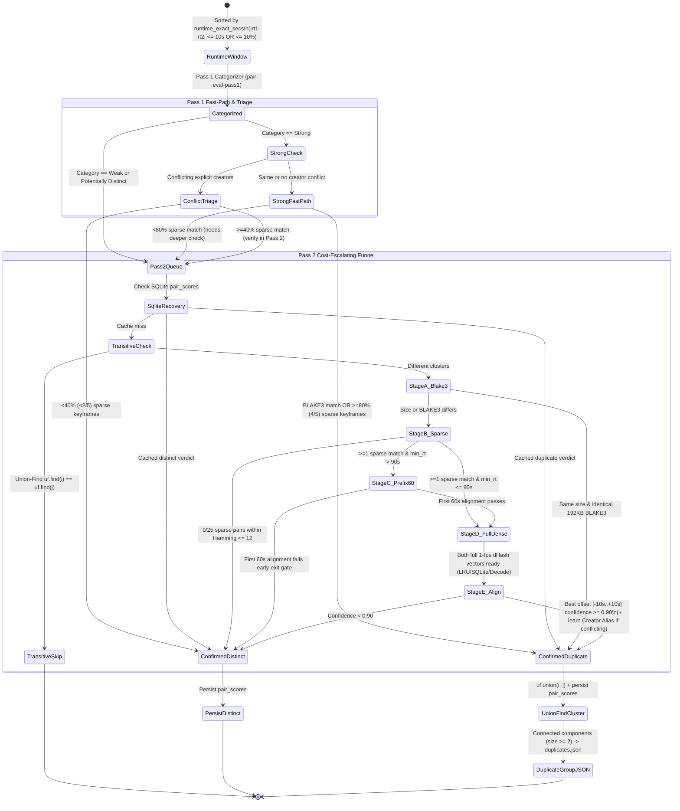
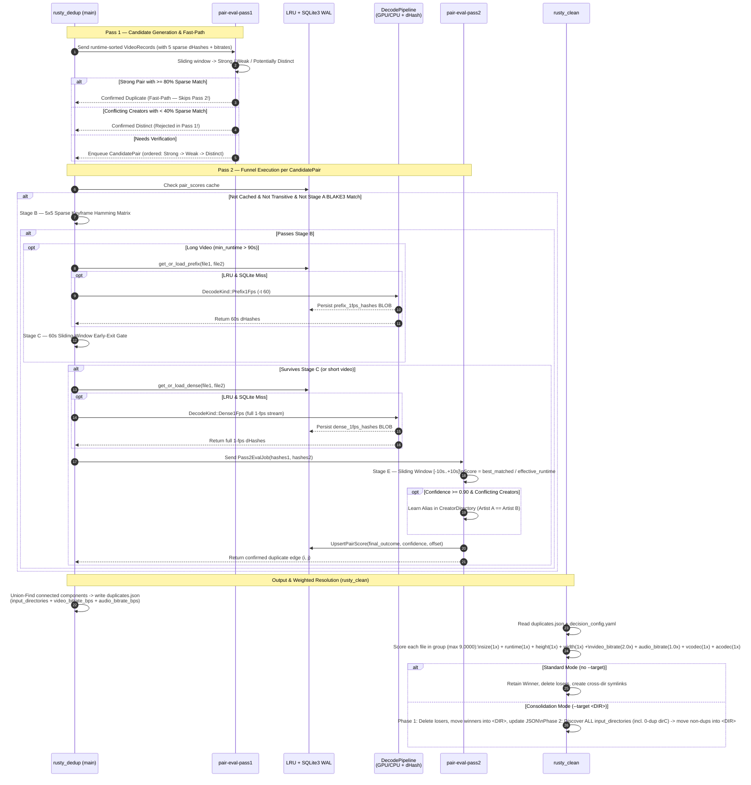

# 02 — Duplicate Detection & Resolution Algorithm

`rusty_dedup` solves duplicate video detection across massive libraries without false positives (such as confusing *Part 1* with *Part 2*, or two short clips with the same studio prefix) and without wasting thousands of GPU hours decoding non-matching videos. It achieves this via a **multi-stage pruning funnel** followed by **weighted quality scoring** in `rusty_clean`.

---

## 1. Perceptual Fingerprinting Foundation (`72×72` GPU → `9×8` Pure-Rust dHash)

Every visual comparison uses a **64-bit Difference Hash (`dHash`)** computed from grayscale luminance (`Y8`) frames:

1. **GPU-Side Downscale (`72×72`)**:
   - FFmpeg decodes frames on the verified hardware accelerator and downscales them on-GPU (e.g., `scale_vt=72:72`, `scale_cuda=72:72`, `scale_vaapi=72:72`, `scale_qsv=72:72`) to `72×72` grayscale (`5,184` bytes/frame).
   - Why `72×72`? It satisfies strict GPU driver minimum surface sizes (`>= 64×64`), cuts frame transfer bandwidth by **600×** vs. 1080p, and is **evenly divisible by both `9` (`8 px/col`) and `8` (`9 px/row`)**.
2. **Exact Integer Area-Average (`72×72 → 9×8`)**:
   - In [src/ffmpeg.rs](file:///Users/maildev/coding/rusty_dedup/src/ffmpeg.rs), `cpu-dhash-worker` averages each exact `8×9` pixel tile (`72` pixels per cell) into a `9×8` luminance grid using integer arithmetic (no floating-point blur or fractional interpolation drift).
3. **64-Bit Horizontal Gradient Hash**:
   - For each of the `8` rows and `8` adjacent column pairs (`x` vs `x + 1`), bit `b = row * 8 + x` is set to `1` if `grid[row][x] > grid[row][x + 1]`.
   - Two frames match if their **Hamming distance** `(h1 ^ h2).count_ones() <= max_hamming_distance` (default **`6 / 64` bits**, i.e., **≥ 90.6% bit similarity**). This tolerates re-encoding (H.264 ↔ H.265 ↔ WMV), resolution changes (4K ↔ 720p), slight letterboxing/compression artifacts, and container swaps.

---

## 2. Filename Normalization, Creator Disentanglement & Sequel Protection

Before any pair is categorized, each filename stem passes through a deterministic 4-step pipeline:

1. **CamelCase & Tag Normalization**:
   - Splits `CamelCase` boundaries (`DragonBallZ` → `dragon ball z`), strips encoding/resolution noise (`1080p`, `2160p`, `4k`, `x265`, `hevc`, `aac`, `webrip`, `bluray`, etc.), and normalizes punctuation.
2. **3-Source Progressive Creator Directory (`.states/creator_directory.json`)**:
   - **Source 1 — Persistent Cross-Session Registry**: Checks previously learned canonical creator/studio names and aliases.
   - **Source 2 — Ancestor Directory Discovery**: Walks up parent folders (stopping at mount boundaries like `/Volumes/<drive>`, `/Users/<user>`, `/mnt/<drive>`) to learn studio/artist directory names.
   - **Source 3 — Corpus TF-IDF (`>= 15%` frequency)**: Detects prefix/suffix clauses repeating across `>= 15%` of files with at least 2 distinct subjects.
   - *Junk Filter*: Rejects fragments `< 4` alphanumeric characters or vowel-less strings (e.g., `f`, `1`, `asd`, `dbz`) to avoid corrupting subject extraction.
3. **Subject Isolation & Sequel Hard Gate**:
   - Strips matched creator tokens so `StudioA - Sunset_Episode_1080p.mp4` and `Sunset_Episode.mkv` reduce to the identical subject `"sunset episode"`.
   - Extracts sequel/part markers (`(2)`, `part 2`, `pt2`, `ep2`, `vol2`, trailing `-2`). **Hard Rule**: If two files have **different sequel markers** (e.g., `Clip` vs. `Clip (2)`), name similarity is capped at `0.70` — they can **never** trigger an "almost identical name" match.
4. **Similarity Metric**:
   - Subject titles are compared via **Jaro-Winkler similarity**. Two files have an **almost identical name** iff `subject_sim >= 0.88` AND sequel markers match.

---

## 3. Multi-Stage Duplicate Detection Funnel

### Stage 0 — Runtime-Sorted $O(N \log N + K)$ Sliding Window
Rather than checking all $\binom{N}{2}$ pairs (45 billion comparisons for 300,000 files!), `rusty_dedup` sorts all `VideoRecord`s ascending by `runtime_exact_secs` and only pairs videos within the runtime window:
$$|\text{rt}_1 - \text{rt}_2| \le 10.0\text{s} \quad \text{OR} \quad \frac{|\text{rt}_1 - \text{rt}_2|}{\max(\text{rt}_1, \text{rt}_2)} \le 0.10$$
Any video with **zero** runtime neighbors is **isolated** and skips keyframe extraction completely!

### Pass 1 — Categorization, Strong Fast-Path & Conflict Triage (`pair-eval-pass1`)
For every video that has at least one runtime neighbor, Pass 1b extracts **5 sparse keyframes** at `10%, 30%, 50%, 70%, 90%` of runtime. Then `pair-eval-pass1` categorizes every candidate pair:

| Category | Entry Criteria | Pass 1 Action |
| :--- | :--- | :--- |
| **`Strong`** | Subject sim `>= 0.88` (matching sequels) AND size diff `<= 10%` AND same/unconflicting creator | **Fast-Path Check**: If exact 192 KB `BLAKE3` matches OR `>= 4/5` (`>= 80%`) sparse keyframes match → **Confirmed Duplicate immediately (SKIPS Pass 2!)**. Otherwise queued first for Pass 2. |
| **`Strong` (Conflicting Creators)** | Subject, size, and runtime match, but explicit creators differ (`Artist A` vs. `Artist B`) | **Conflict Triage**: If `< 2/5` (`< 40%`) sparse keyframes match → **Confirmed Distinct immediately in Pass 1**. Otherwise queued for Pass 2; if Pass 2 confirms duplicate, automatically links `Artist A == Artist B` in `creator_directory.json`. |
| **`Weak`** | Almost identical subject (different size/codec) **OR** size diff `<= 10%` (different subject) | Queued for Pass 2 after `Strong` pairs. |
| **`Potentially Distinct`** | Remaining pairs within the runtime window | Queued for Pass 2 last. |

### Pass 2 — 6-Gate Cost-Escalating Confirmation Funnel (`main` + `DecodePipeline` + `pair-eval-pass2`)
Each queued pair traverses gates ordered strictly from **cheapest (`~1 µs`) to most expensive (full 1-fps GPU decode)**:

1. **SQLite3 WAL Recovery (`pair_scores`)**: If this exact `(file_key_a, file_key_b)` pair was evaluated in an earlier run, immediately replay its verdict and skip all work.
2. **Union-Find Transitive Skip**: If `uf.find(i) == uf.find(j)` (already linked transitively through another confirmed duplicate `A == B` and `B == C`), skip `A vs C` immediately.
3. **Stage A — Exact Byte-Size + 192 KB `BLAKE3` Sample**: If byte sizes match and the `BLAKE3(size || first 64KB || mid 64KB || last 64KB)` hashes match → **Confirmed Duplicate (100% confidence)**.
4. **Stage B — 5×5 Sparse Keyframe Gate**: Compares all `5 × 5 = 25` pairs of sparse keyframes (tolerant to intro/outro time shifts) using tolerance `min(max_hamming + 4, 12)` bits. If **zero** of the 25 pairs match → **Confirmed Distinct** (avoids 95%+ of all video decodes!).
5. **Stage C — 60-Second Early-Exit (`-t 60`) for Long Videos (`min_runtime > 90s`)**:
   - Decodes only the **first 60 seconds** at 1 fps (cached in `Prefix 1-fps LRU` + SQLite `prefix_1fps_hashes` BLOB).
   - Runs sliding-window alignment (`[-10s..+10s]`) on the first 60s. If matched frames `< 50%` of the early-exit threshold → **Confirmed Distinct** without ever decoding the remaining 59+ minutes!
6. **Stage D — Lazy Full 1-fps Decode**:
   - Only pairs surviving Stage C decode full 1-fps hashes (reusing `Dense 1-fps LRU` or SQLite `dense_1fps_hashes` BLOB if already decoded for an earlier pair).
7. **Stage E — Sliding-Window Alignment & Confidence Scoring (`pair-eval-pass2`)**:
   - Slides `offset` across `[-max_slide_offset .. +max_slide_offset]` (default `[-10s .. +10s]`) to tolerate trimmed intros/outros.
   - At each offset, counts seconds where `(h1[t] ^ h2[t + offset]).count_ones() <= max_hamming_distance`.
   - Computes:
     $$\text{Confidence} = \min\left(1.0,\ \frac{\text{best\_matched\_seconds}}{\min(\text{len}_1, \text{len}_2, \text{rt}_1, \text{rt}_2)}\right)$$
   - If `Confidence >= min_confidence` (default **`0.90`**) → **Confirmed Duplicate** (`uf.union(i, j)` + learn creator alias if creators differed). Otherwise → **Confirmed Distinct**.

---

## 4. State-Machine Diagram: Candidate Pair Lifecycle

---

## 5. Sequence Diagram: End-to-End Detection & `rusty_clean` Resolution

---

## 6. Resolution Scoring in `rusty_clean` (`decision_config.yaml`)

When `rusty_clean` resolves a duplicate group of size $N$, each file receives a normalized score out of **`9.0000`**:

| Attribute | Direction (Default) | Weight | Scoring Formula |
| :--- | :--- | :---: | :--- |
| `size_in_bytes` | `lower is better` | `1.0×` | Rank points $(N - \text{strictly\_better}) / N$ |
| `runtime_in_seconds` | `higher is better` | `1.0×` | Rank points $(N - \text{strictly\_better}) / N$ |
| `video_height` | `higher is better` | `1.0×` | Rank points $(N - \text{strictly\_better}) / N$ |
| `video_width` | `higher is better` | `1.0×` | Rank points $(N - \text{strictly\_better}) / N$ |
| `video_bitrate` (`video_bitrate_bps`) | `higher is better` | **`2.0×`** | $\text{Rank normalized} \times 2.0$ (double weight of audio bitrate) |
| `audio_bitrate` (`audio_bitrate_bps`) | `higher is better` | **`1.0×`** | $\text{Rank normalized} \times 1.0$ |
| `video_codec` | Configured map (`AV1=11`, `H265=10`, `H264=9`, ...) | `1.0×` | $\text{codec\_score} / \text{max\_score}$ |
| `audio_codec` | Configured map (`AAC=10`, `OPUS=9`, `AC3=8`, ...) | `1.0×` | $\text{codec\_score} / \text{max\_score}$ |

- **Tie-breaker**: Shortest file path (`file_path.len()`), then lexicographical order.
- **`--target <DIRECTORY_PATH>` Consolidation**: Deletes duplicates (skipping symlinks), moves retained winners into `<DIRECTORY_PATH>` (with automatic `_1`/`_2` collision safety and cross-volume 4 MiB chunked progress), discovers **all** scanned input directories via `duplicates.json`'s `input_directories` (and SQLite3 `.states/rusty_session_*.db` fallback — ensuring directories with 0 duplicates like `dirC` are still merged!), moves all non-duplicate videos into `<DIRECTORY_PATH>`, and rewrites `duplicates.json` with updated winner paths.
