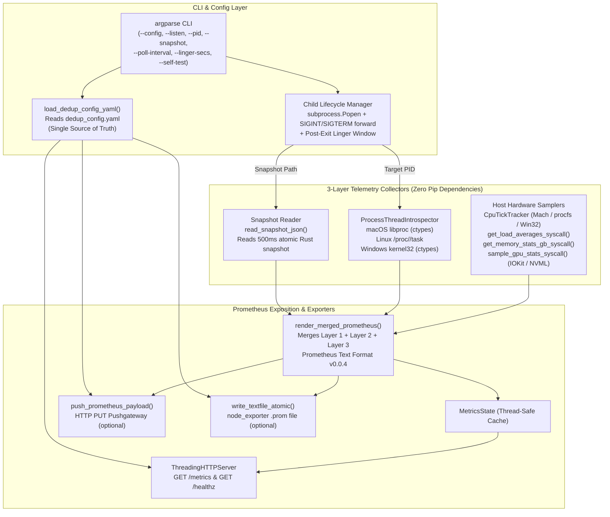
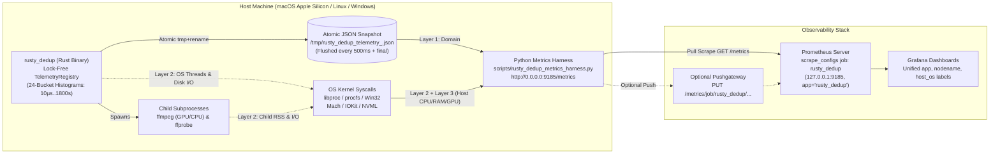

# 03 — Metrics Collection, Python Harness & Complete Metrics Reference

`rusty_dedup` provides full-stack APM observability combining **in-process lock-free Rust domain instrumentation** with a **zero-dependency external Python Metrics Harness** ([scripts/rusty_dedup_metrics_harness.py](file:///Users/maildev/coding/rusty_dedup/scripts/rusty_dedup_metrics_harness.py)) that introspects OS-kernel thread states, child `ffmpeg`/`ffprobe` processes, and host CPU/RAM/GPU hardware via native C syscalls.

---

## 1. Why a Hybrid Python Metrics Harness?

An external OS process using native unprivileged C syscalls can observe **everything the OS kernel knows** about `rusty_dedup`'s threads and child processes — with zero root/admin privileges and zero runtime overhead on Rust's hot loop:

| OS | Unprivileged Native Syscall / API Used by Harness | Kernel Metrics Captured Externally |
| :--- | :--- | :--- |
| **macOS** *(Apple Silicon & Intel)* | `ctypes` → `/usr/lib/libSystem.B.dylib`: `proc_pidinfo(PROC_PIDLISTTHREADS=6)`, `proc_pidinfo(PROC_PIDTHREADINFO=5)`, `proc_pid_rusage(RUSAGE_INFO_V4=4)`, `proc_listchildpids()`, `proc_name()` | Exact Rust thread names (`pth_name`), per-thread user/system CPU ns, instantaneous CPU %, thread run state (`running`, `waiting`, `disk_io`), resident memory & disk read/write bytes for `rusty_dedup` and live child `ffmpeg`/`ffprobe` processes. *(Avoids Mach `task_for_pid()` which macOS SIP blocks.)* |
| **Linux** | Direct `/proc/<pid>/task/<tid>/{comm,stat,children}`, `/proc/<pid>/{statm,io}` | Exact Rust thread names, per-thread user/kernel CPU time, scheduler state (`R`/`S`/`D`), RSS, disk read/write bytes, and child `ffmpeg`/`ffprobe` tree. |
| **Windows** | `ctypes` → `kernel32.dll`: `CreateToolhelp32Snapshot(TH32CS_SNAPTHREAD)`, `OpenThread(THREAD_QUERY_LIMITED_INFORMATION)`, `GetThreadTimes()`, `GetThreadDescription()` | Per-thread names (Win10+), kernel & user CPU times, thread enumeration across `rusty_dedup.exe`. |

However, the OS kernel cannot see **application-domain semantics** (such as H.265 `8.0×` realtime decode speed, 24-bucket job latency histograms, bounded LRU hit rates, SQLite3 WAL commit batch sizes, duplicate funnel short-circuits, or `ffprobe` bitrate extraction sources).

Therefore, `rusty_dedup` flushes a tiny **atomic JSON telemetry snapshot** (`/tmp/rusty_dedup_telemetry_<pid>.json`) every `500 ms` (plus a final `finished: true` snapshot on exit). The Python harness merges **all three layers** into a single **Prometheus Text Exposition v0.0.4** endpoint (`GET :9185/metrics`) — and holds the endpoint alive for `--linger-secs 20` after `rusty_dedup` exits so Prometheus never misses the final end-of-run counters!

---

## 2. Single Source of Truth (`dedup_config.yaml`) & Invocation Modes

Both `rusty_dedup` (standalone) and `scripts/rusty_dedup_metrics_harness.py` read the `telemetry.prometheus` block in [dedup_config.yaml](file:///Users/maildev/coding/rusty_dedup/dedup_config.yaml) by default (`listen_addr: 0.0.0.0:9185`, `pushgateway_url`, `push_interval_secs`, `job_name`, `textfile_path`):

- **Harness Mode (Recommended)**:
  ```bash
  python3 scripts/rusty_dedup_metrics_harness.py -- \
      ./target/release/rusty_dedup /Volumes/MediaA /Volumes/MediaB -o duplicates.json
  ```
  The harness sets `RUSTY_DEDUP_HARNESS_ACTIVE=1` and `RUSTY_DEDUP_TELEMETRY_SNAPSHOT=/tmp/rusty_dedup_telemetry_<pid>.json` in the child environment, so `rusty_dedup` automatically skips binding `:9185` itself (zero port conflict), forwards `SIGINT`/`SIGTERM`, and streams stdout/stderr transparently.
- **Attach Mode**:
  ```bash
  python3 scripts/rusty_dedup_metrics_harness.py --pid 12345 \
      --snapshot /tmp/rusty_dedup_telemetry_12345.json
  ```
- **Self-Test Mode** (empirically verifies cross-PID OS thread syscalls, host hardware samplers, and Prometheus v0.0.4 rendering):
  ```bash
  python3 scripts/rusty_dedup_metrics_harness.py --self-test
  ```
- **Standalone Rust Mode**: Running `./target/release/rusty_dedup ...` directly (without the harness) still serves Layer 1 metrics on `:9185/metrics` via Rust's built-in `PrometheusScrapeServer` and prints the full end-of-run APM dashboard.

---

## 3. Component Diagram (`scripts/rusty_dedup_metrics_harness.py`)



---

## 4. End-to-End Observability Architecture Diagram



---

## 5. 24-Bucket Latency Histogram Design

All latency histograms in `src/telemetry.rs` use **24 lock-free Prometheus-aligned buckets** spanning **8 orders of magnitude** (`10µs` to `30 minutes`):

```text
10µs, 25µs, 50µs, 100µs, 250µs, 500µs,
1ms, 2.5ms, 5ms, 10ms, 25ms, 50ms, 100ms, 250ms, 500ms,
1s, 2.5s, 5s, 15s, 60s, 120s, 300s, 600s, 1800s, +Inf
```

- **Why 10µs at the low end?** SQLite3 WAL cache hits (`~15–30µs`) and Pass-1 pair evaluations (`~5–20µs`) are accurately resolved instead of clamping at `0.1ms`.
- **Why 1800s at the high end?** Long 1–2 hour 4K/H.265 full-video decodes (`100s–500s`) get accurate `p95` and `p99` quantiles instead of overflowing a `60s` cap and collapsing `p95 == max`.

---

## 6. Complete Metrics Catalog (All 3 Layers)

### Layer 1 — Rust In-Process Application & Pipeline Metrics (`src/prometheus.rs` & `src/telemetry.rs`)

#### 6.1 Session Metadata & Lifecycle

| Metric Name & Type | Labels | What It Means | Why We Collect It | Insights & Tuning Actions |
| :--- | :--- | :--- | :--- | :--- |
| `rusty_dedup_info` (`gauge`, value `1`) | `version`, `session_id`, `hw_backend`, `hw_scale` | Static metadata identifying the running binary version, deterministic session hash, active GPU backend (`videotoolbox`, `cuda`, `cpu`), and downscale target (`72x72`). | Tags every Grafana run with exact hardware & session context so regressions across runs are immediately explainable. | Confirms expected GPU backend and `72x72` exact-integer downscaling are active during unattended overnight runs. |
| `rusty_dedup_phase` (`gauge`, `0` or `1`) | `phase` (`config_test`, `walk`, `pass1_ffprobe`, `pass1_keyframes`, `pass1_eval`, `pass2_eval`, `output`, `done`) | One-hot indicator of which pipeline stage is currently executing. | Lets Grafana overlay phase transitions on CPU/GPU/disk graphs. | Pinpoints how much total wall time is spent in Walk vs. Pass 1 probing vs. Pass 2 decoding. |
| `rusty_dedup_uptime_seconds` (`gauge`) | *(none)* | Wall-clock elapsed seconds since `rusty_dedup` started. | Tracks total runtime duration for SLA and ETA calculations. | Correlates elapsed wall time against jobs completed to project finish times for 300K-file scans. |

#### 6.2 Per-Thread USE (Utilization, Saturation, Errors) + RED (Rate, Errors, Duration)

| Metric Name & Type | Labels | What It Means | Why We Collect It | Insights & Tuning Actions |
| :--- | :--- | :--- | :--- | :--- |
| `rusty_dedup_thread_time_seconds_total` (`counter`) | `thread`, `state` (`busy`, `starved`, `backpressured`) | Cumulative seconds each worker thread spent doing active work (`busy`), waiting on upstream input (`starved`), or blocked pushing to a full downstream queue (`backpressured`). | Core USE-method bottleneck detector across the multi-threaded pipeline. | Immediately identifies the true bottleneck stage: a thread with `busy ≈ 100%` and `backpressured ≈ 0%` (e.g., `gpu_decode_worker`) is the system throughput limit; `backpressured > 10%` means the *next* stage downstream is saturated; `starved ≈ 100%` means the stage is fast and waiting on upstream work. |
| `rusty_dedup_thread_jobs_total` (`counter`) | `thread` | Total discrete jobs completed by each worker thread (actual `ffprobe` calls, video decodes, dHash batches, pair evaluations, SQLite commits). | Enables both wall-clock throughput (`rate(...)`) and active throughput (`jobs / busy_seconds`). | Reveals true processing capacity per stage (e.g., `pair_evaluator_pass2` processing `~5,000 pairs/s` when active even if wall rate is `22/hour`). |
| `rusty_dedup_thread_errors_total` (`counter`) | `thread` | Count of errors handled by each thread (corrupt media files, `ffprobe` failures, decode errors, DB open errors). | Surfaces silent file corruption or driver issues early. | Rising `ffprobe_workers` or `cpu_decode_worker` errors point to bad sectors, permissions, or truncated files on a specific volume. |
| `rusty_dedup_thread_job_duration_seconds` (`histogram`) | `thread`, `le` (24 buckets) | Per-job execution latency distribution (`_bucket`, `_sum`, `_count`). | Captures tail latency (`p50`, `p95`, `p99`) that averages hide. | Distinguishes normal 60s prefix decodes (`~8s`) from multi-hour 4K H.265 outliers (`300s+`) and ensures `cpu_dhash_worker` stays in sub-millisecond range. |

#### 6.3 Per-Volume HDD Probing & FFprobe Bitrate Telemetry

| Metric Name & Type | Labels | What It Means | Why We Collect It | Insights & Tuning Actions |
| :--- | :--- | :--- | :--- | :--- |
| `rusty_dedup_volume_files_total` (`counter`) | `dev_id`, `outcome` (`probed`, `sqlite_hit`, `bitrate_reprobe`, `skipped_error`) | Files processed per physical disk device ID broken down by fresh `ffprobe`, SQLite cache hit, on-demand 0-bitrate re-probe, or error. | Separates cold HDD probing from warm SQLite resumes per physical drive. | Confirms resume efficiency (e.g., `100% sqlite_hit`), tracks one-time bitrate backfill progress (`bitrate_reprobe`), and isolates failing drives (`skipped_error`). |
| `rusty_dedup_volume_blake3_bytes_total` (`counter`) | `dev_id` | Total file sample bytes (up to 192 KB/file) read for `BLAKE3` exact-size collision hashing per drive. | Quantifies extra disk reads triggered by same-size files. | Verifies BLAKE3 pre-filtering stays lightweight (typically a few MB total). |
| `rusty_dedup_volume_ffprobe_duration_seconds` (`histogram`) | `dev_id`, `le` | Actual `ffprobe` subprocess header-read latency per physical HDD `dev_id`. | Measures real platter seek + header parse latency per drive without contamination from microsecond SQLite cache hits. | Spots slow USB bridges, SMR HDD stalls, or head contention (if `p95 > 200ms`, keep `--hdd-concurrency 1`). |
| `rusty_dedup_volume_sqlite_lookup_duration_seconds` (`histogram`) | `dev_id`, `le` | SQLite3 WAL cache lookup latency (`get_compact_file_record`) per volume. | Tracks warm-resume read performance independently from `ffprobe`. | Verifies SQLite index lookups stay in the `15–50µs` range; spikes indicate DB page cache pressure or slow states storage. |
| `rusty_dedup_ffprobe_bitrate_source_total` (`counter`) | `stream` (`video`, `audio`), `source` (`stream`, `tag_bps`, `container_fallback`, `size_fallback`, `missing`) | Counts how `video_bitrate_bps` and `audio_bitrate_bps` were resolved across containers. | Validates bitrate data quality across heterogeneous `.mp4`, `.mkv`, `.avi`, `.wmv`, and `.webm` archives. | Shows what share of files had exact stream metadata (`stream` / MKV `tag_bps`) vs. estimated (`container_fallback` / `size_fallback`) vs. missing audio bitrates. |

#### 6.4 Video Decode Engine & Pure-Rust `9×8` dHash Metrics

| Metric Name & Type | Labels | What It Means | Why We Collect It | Insights & Tuning Actions |
| :--- | :--- | :--- | :--- | :--- |
| `rusty_dedup_decode_video_seconds_total` (`counter`) | `engine` (`gpu`, `cpu`), `codec`, `kind` (`sparse5`, `prefix60`, `dense`) | Cumulative seconds of video content decoded per engine, codec, and stage. | Numerator for exact realtime decode speed calculation. | Quantifies total media hours decoded (e.g., 100+ hours of H.265 video scanned). |
| `rusty_dedup_decode_wall_seconds_total` (`counter`) | `engine`, `codec`, `kind` | Cumulative wall-clock seconds spent decoding per engine, codec, and stage. | Denominator for realtime factor: `decode_video_seconds_total / decode_wall_seconds_total`. | Directly reveals decode throughput in `× realtime` per codec (e.g., `H264 27.3×` vs. `H265 8.0×`), highlighting which codecs dominate wall time. |
| `rusty_dedup_decode_frames_total` (`counter`) | `engine`, `codec`, `kind` | Total decoded frames emitted by FFmpeg per engine/codec/kind. | Measures exact frame volume across sparse, 60s prefix, and full dense stages. | Shows whether `dense` or `prefix60` accounts for the majority of decoded frames. |
| `rusty_dedup_gpu_hw_scale_fallbacks_total` (`counter`) | `codec` | Number of GPU-decoded files that had to fall back from GPU-side scaling (e.g., `scale_vt`) to CPU `scale=72:72`. | Detects unexpected GPU filtergraph failures (e.g., 10-bit pixel format quirks). | Non-zero values warn that full-resolution frames crossed GPU→CPU memory, increasing RAM bandwidth and CPU usage. |
| `rusty_dedup_gpu_to_cpu_routes_total` (`counter`) | `codec`, `reason` (`legacy_codec`, `codec_rejected`) | Files routed from GPU to `cpu-decode-worker` either proactively (`legacy_codec` like WMV/MPEG4) or after per-file GPU rejection (`codec_rejected`). | Tracks how much work spills onto CPU software decoders. | If `> 15%` of jobs route to CPU (flagged by Bottleneck Advisor), reveals codecs that may benefit from transcoding or CPU thread tuning. |
| `rusty_dedup_dhash_frames_total` (`counter`) | `path` (`integer_exact`, `fractional`) | Frames hashed via the fast exact integer `8×9` block-average path (`72×72`) vs. fractional fallback. | Confirms the `72×72` optimization is actually engaged. | Should be 100% `integer_exact`; any `fractional` count means `hw_scale_width`/`hw_scale_height` in `dedup_config.yaml` isn't a multiple of `9×8`. |
| `rusty_dedup_dhash_frame_duration_seconds` (`histogram`) | `le` | Per-frame pure-Rust `9×8` downscale + 64-bit dHash compute duration. | Ensures perceptual hashing stays orders of magnitude faster than decoding. | Typically `< 5µs/frame`; confirms CPU hashing will never bottleneck `gpu_decode_worker`. |

#### 6.5 Bounded Queues, In-Flight Memory & LRU Caches

| Metric Name & Type | Labels | What It Means | Why We Collect It | Insights & Tuning Actions |
| :--- | :--- | :--- | :--- | :--- |
| `rusty_dedup_channel_depth` (`gauge`) | `channel` (`stage_frames`, `eval_pairs`, `sqlite_pending`) | Current live queue occupancy for the 3 internal handoff channels. | Real-time queue saturation visibility during long runs. | Sustained `stage_frames == 16` indicates `cpu_dhash_worker` bottleneck; rising `sqlite_pending` indicates disk commit lag. |
| `rusty_dedup_channel_depth_peak` (`gauge`) | `channel` | High-water mark occupancy reached during the entire run. | Captures transient burst spikes even between Prometheus scrapes. | Validates that `sync_channel(16)` provides plenty of headroom without wasting RAM. |
| `rusty_dedup_inflight_luma_bytes` & `rusty_dedup_inflight_luma_bytes_peak` (`gauge`) | *(none)* | Current and peak RAM bytes held in raw `72×72` luma buffers inside `stage_channel(16)`. | Verifies memory safety on multi-hour videos. | Confirms peak staged frame memory stays tiny (e.g., ~25 MB vs. gigabytes without GPU `72×72` downscaling). |
| `rusty_dedup_lru_cache_ops_total` (`counter`) | `cache` (`prefix`, `dense`), `outcome` (`hit`, `sqlite_reload`, `miss_decode`, `eviction`) | Operations on the two 2,000-entry `BoundedHashCache` LRUs. | Measures cache effectiveness and detects LRU thrashing. | High `eviction` + `sqlite_reload` with hit rate `< 80%` (flagged by Bottleneck Advisor) indicates `HASH_LRU_CAPACITY` should be raised above `2000`. |

#### 6.6 Duplicate Funnel, Work Avoided, SQLite3 WAL & Process Resources

| Metric Name & Type | Labels | What It Means | Why We Collect It | Insights & Tuning Actions |
| :--- | :--- | :--- | :--- | :--- |
| `rusty_dedup_funnel_pairs_total` (`counter`) | `stage` (`pass1_strong_confirmed`, `pass1_conflict_rejected`, `pass2_sqlite_recovered`, `pass2_transitive_skip`, `pass2_blake3_exact`, `pass2_stage_b_rejected`, `pass2_stage_c_60s_rejected`, `pass2_stage_e_confirmed`, `pass2_stage_e_distinct`) | Number of candidate pairs resolved at every stage of the duplicate detection funnel. | Quantifies the exact pruning power of each cheap heuristic gate. | Shows what percentage of pairs are eliminated by Stage B sparse screening (`~99%+`) and Stage C 60s early-exit before reaching full 1-fps decode. |
| `rusty_dedup_video_seconds_avoided_total` (`counter`) | `stage` (`pass1_isolated`, `pass1_strong`, `stage_b_sparse`, `stage_c_60s`) | Estimated video seconds spared from full 1-fps decoding by each short-circuit gate. | Quantifies ROI of the algorithmic funnel in concrete hours saved. | Demonstrates massive compute savings (e.g., `76,000+` hours of unnecessary video decoding avoided in a single run). |
| `rusty_dedup_sqlite_commits_total` & `rusty_dedup_sqlite_mutations_total` (`counter`) | *(none)* | Total batched WAL transactions committed and total row mutations persisted. | Tracks write amplification and batching efficiency (`mutations / commits`). | High average batch size (`100–500`) confirms `AsyncDbWriter` is amortizing `fsync` overhead effectively. |
| `rusty_dedup_sqlite_commit_duration_seconds` (`histogram`) | `le` | Latency distribution of batched SQLite3 WAL transaction commits. | Detects slow state storage (e.g., putting `--states-dir` on a spinning HDD or network mount). | If `p99 > 200ms` (flagged by Bottleneck Advisor), move `--states-dir` to a local internal SSD/NVMe. |
| `rusty_dedup_sqlite_file_bytes` (`gauge`) | `kind` (`db`, `wal`) | On-disk size in bytes of `rusty_session_{id}.db` and its `-wal` journal file. | Monitors state store growth and WAL checkpoint health. | Ensures `-wal` does not grow unboundedly and drops to `0` after clean `PRAGMA wal_checkpoint(TRUNCATE)`. |
| `rusty_dedup_process_max_rss_bytes` (`gauge`) | *(none)* | Peak resident set size (RSS) of the `rusty_dedup` process via Unix `getrusage(RUSAGE_SELF)`. | Verifies flat bounded RAM across 300K-file scans. | Confirms zero memory leaks (e.g., ~120 MB peak RSS over a 12.5-hour run). |
| `rusty_dedup_process_cpu_seconds_total` (`counter`) | `target` (`rust_self`, `ffmpeg_children`), `mode` (`user`, `sys`) | Cumulative CPU time consumed by Rust itself vs. reaped `ffmpeg`/`ffprobe` child processes (`getrusage`). | Separates Rust coordinator overhead from FFmpeg media decode CPU cost. | Typically confirms Rust uses `< 1%` of total CPU (`65s` Rust vs. `9,646s` FFmpeg), proving zero Rust CPU bottleneck. |

---

### Layer 2 — External OS-Kernel Thread & Child Process Metrics (`scripts/rusty_dedup_metrics_harness.py`)

All Layer 2 metrics carry unified `nodename` and `host_os` labels (matching `rusty_h265_converter` Grafana dashboards).

| Metric Name & Type | Labels | What It Means | Why We Collect It | Insights & Tuning Actions |
| :--- | :--- | :--- | :--- | :--- |
| `rusty_dedup_harness_target_alive` (`gauge`, `0` or `1`) | `nodename`, `host_os`, `pid` | Whether the monitored `rusty_dedup` PID is currently running (`1`) or has exited into the post-exit linger window (`0`). | Alerts when a long overnight run finishes or unexpectedly terminates. | Cleanly marks exact run start/end boundaries in Grafana annotations. |
| `rusty_dedup_os_thread_cpu_seconds_total` (`counter`) | `nodename`, `host_os`, `thread_name`, `tid`, `mode` (`user`, `system`) | Kernel-measured cumulative CPU seconds spent by every individual OS thread inside `rusty_dedup` (`libproc` / `/proc/task` / `GetThreadTimes`). | Independently validates in-process Rust timers from outside the process and separates userspace compute (`user`) from kernel syscalls (`system`). | High `system` CPU on `sqlite-wal-writer` or `ffprobe_workers` reveals syscall/I/O overhead; near-zero CPU on `gpu-decode-worker` confirms FFmpeg child does the work while Rust waits on the pipe. |
| `rusty_dedup_os_thread_cpu_usage_ratio` (`gauge`) | `nodename`, `host_os`, `thread_name`, `tid` | Kernel-reported instantaneous per-thread CPU usage ratio (`0.0 .. 1.0`). | Shows live per-thread core saturation without needing `rate()` windows. | Pinpoints whether any single Rust thread is pegging a CPU core during Pass 1 or Pass 2. |
| `rusty_dedup_os_thread_state` (`gauge`, `1`) | `nodename`, `host_os`, `thread_name`, `tid`, `state` (`running`, `waiting`, `disk_io`, `stopped`, `halted`, `other`) | Live OS kernel scheduler state of every thread (`TH_STATE_UNINTERRUPTIBLE` / Linux `D` state mapped to `disk_io`). | Reveals **kernel-level uninterruptible disk I/O stalls** that userspace timers cannot distinguish from normal sleep. | Threads stuck in `state="disk_io"` directly diagnose spinning-HDD stalls, USB enclosure hangs, or APFS/ext4 journal locks. |
| `rusty_dedup_os_process_rss_bytes` (`gauge`) | `nodename`, `host_os`, `role` (`rusty_dedup`, `ffmpeg`, `ffprobe`, ...) | Live resident memory (RSS) of `rusty_dedup` AND its active child `ffmpeg`/`ffprobe` processes combined by role. | `getrusage(RUSAGE_SELF)` in Rust cannot see live child `ffmpeg` memory; external kernel introspection captures the full process tree's RAM footprint. | Detects FFmpeg decoder memory spikes on 4K/8K or high-reference-frame H.265/AV1 clips before macOS/Linux starts swapping. |
| `rusty_dedup_os_process_disk_io_bytes_total` (`counter`) | `nodename`, `host_os`, `role`, `direction` (`read`, `write`) | Cumulative kernel-tracked physical disk bytes read and written by `rusty_dedup` and active child `ffmpeg`/`ffprobe` processes (`ri_diskio_bytesread` / `/proc/<pid>/io`). | Measures actual storage bandwidth consumed by probing and decoding. | Computes true MB/s read throughput from external HDDs (`rate(...[1m])`) to check if HDD read bandwidth is saturated or throttled by USB/enclosure speed. |
| `rusty_dedup_os_child_processes_active` (`gauge`) | `nodename`, `host_os`, `name` (`ffmpeg`, `ffprobe`) | Count of currently running child `ffmpeg` and `ffprobe` processes under `rusty_dedup`. | Confirms child subprocess concurrency stays strictly bounded (no zombie/leaked FFmpeg processes). | Should stay `<= 2` for `ffmpeg` (`gpu-decode` + `cpu-decode`) and `<= num_volumes * hdd_concurrency` for `ffprobe`. |

---

### Layer 3 — Host Hardware Telemetry (`scripts/rusty_dedup_metrics_harness.py`)

Reuses the zero-dependency OS/GPU syscall engine from `rusty_h265_metrics_agent.py` with identical `nodename` and `host_os` labels for seamless Grafana dashboard parity.

| Metric Name & Type | Labels | What It Means | Why We Collect It | Insights & Tuning Actions |
| :--- | :--- | :--- | :--- | :--- |
| `rusty_dedup_host_cpu_utilization_ratio` (`gauge`) | `nodename`, `host_os`, `mode` (`user`, `system`, `idle`, `active`) | Whole-machine CPU utilization breakdown (`0.0 .. 1.0`) via Mach `host_statistics`, `/proc/stat`, or Win32 `GetSystemTimes`. | Contextualizes `rusty_dedup` performance against total host CPU pressure (e.g., if `rusty_h265_converter` or Spotlight is running simultaneously). | Determines if host CPU contention is slowing down `cpu_decode_worker` or FFmpeg demuxing. |
| `rusty_dedup_host_load_average` (`gauge`) | `nodename`, `host_os`, `window` (`1m`, `5m`, `15m`) | System run-queue + uninterruptible disk-wait load average (`os.getloadavg()`). | Standard Unix indicator of CPU + disk I/O queue pressure. | High load average alongside low CPU % is a classic signature of external HDD I/O wait saturation. |
| `rusty_dedup_host_memory_gb` (`gauge`) | `nodename`, `host_os`, `state` (`used`, `free`, `total`, `wired`, `compressed`) | Host physical memory breakdown in GiB (including macOS `wired` and `compressed` VM pools via Mach `host_statistics64`). | Monitors unified-memory pressure on Apple Silicon Macs (where GPU decode surfaces share system RAM). | Rising `compressed` memory warns of memory pressure that could throttle VideoToolbox or cause OS swap thrashing. |
| `rusty_dedup_host_gpu_utilization_ratio` (`gauge`) | `nodename`, `host_os`, `gpu`, `engine` (`core`, `decoder`, `renderer`, `tiler`) | Live GPU utilization (`0.0 .. 1.0`) via macOS `IOAccelerator` (`ioreg`) or NVIDIA NVML `ctypes` (`nvmlDeviceGetDecoderUtilization`). | Proves hardware video decoding is actively utilizing the silicon media/GPU engines. | Confirms VideoToolbox/NVDEC utilization during Pass 2; `0%` GPU utilization while `gpu_decode_worker` is busy would flag an unexpected decode bottleneck (e.g., HDD read starvation feeding the GPU). |
| `rusty_dedup_host_gpu_memory_mb` (`gauge`) | `nodename`, `host_os`, `gpu`, `state` (`used`, `total`) | Live GPU / VRAM (or Apple Silicon allocated accelerator memory) in MiB. | Tracks GPU memory headroom alongside other GPU workloads. | Ensures `rusty_dedup`'s `72×72` GPU surfaces leave plenty of VRAM free even when running alongside encoding or desktop apps. |

---

## 7. Built-In APM Bottleneck Advisor & Useful PromQL Queries

At the end of every run, `rusty_dedup` automatically evaluates 4 heuristic rules in [evaluate_bottleneck_advisor](file:///Users/maildev/coding/rusty_dedup/src/telemetry.rs#L1045-L1104):
1. **`gpu_decode_worker` backpressured `> 10%`**: Warns `cpu_dhash_worker` is saturated on `sync_channel(16)`.
2. **`Dense 1-fps LRU` evictions `> 0` and hit rate `< 80%`**: Recommends raising `HASH_LRU_CAPACITY` above `2000`.
3. **SQLite3 WAL commit `p99 > 200ms`**: Recommends moving `--states-dir` to a local SSD/NVMe.
4. **GPU→CPU codec routing `> 15%` of decode jobs**: Reports which legacy/rejected codecs fell back to `cpu_decode_worker`.

### Ready-to-Use Grafana PromQL Queries

```promql
# 1. Per-thread Busy Utilization (%) over 1m window
100 * rate(rusty_dedup_thread_time_seconds_total{app="rusty_dedup",state="busy"}[1m])
  / ignoring(state) group_left
  sum by (thread) (rate(rusty_dedup_thread_time_seconds_total{app="rusty_dedup"}[1m]))

# 2. Decode Realtime Speed (x realtime) by Engine & Codec
rusty_dedup_decode_video_seconds_total{app="rusty_dedup"}
  / rusty_dedup_decode_wall_seconds_total{app="rusty_dedup"}

# 3. GPU Decode p95 Latency (seconds) using the 24-bucket histogram
histogram_quantile(0.95, sum by (le) (rate(rusty_dedup_thread_job_duration_seconds_bucket{app="rusty_dedup",thread="gpu_decode_worker"}[5m])))

# 4. Per-Volume Actual FFprobe p95 Latency (ms)
1000 * histogram_quantile(0.95, sum by (le, dev_id) (rate(rusty_dedup_volume_ffprobe_duration_seconds_bucket{app="rusty_dedup"}[5m])))

# 5. Live External OS-Kernel Thread CPU Rate (from Python Harness)
rate(rusty_dedup_os_thread_cpu_seconds_total{app="rusty_dedup"}[1m])

# 6. Total Disk Read Throughput Across rusty_dedup + Child FFmpeg (MB/s)
sum by (role) (rate(rusty_dedup_os_process_disk_io_bytes_total{app="rusty_dedup",direction="read"}[1m])) / 1048576

# 7. Total Estimated Full-Video Decode Hours Avoided by Funnel
sum(rusty_dedup_video_seconds_avoided_total{app="rusty_dedup"}) / 3600
```
